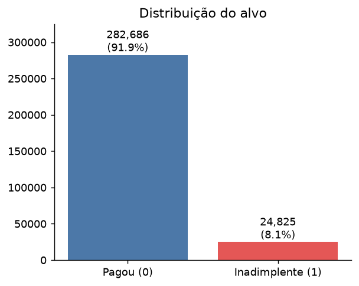
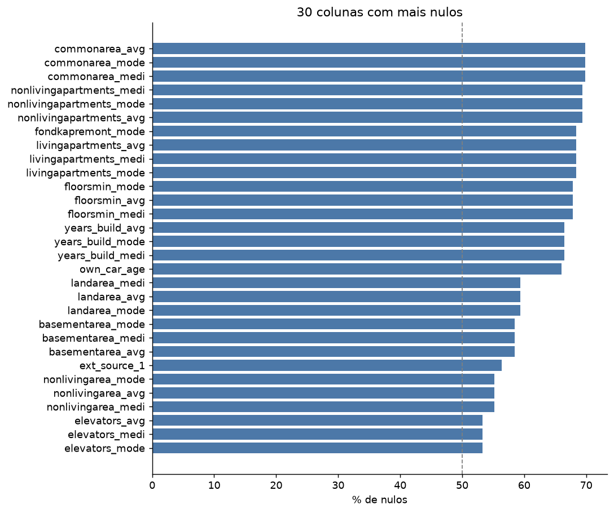
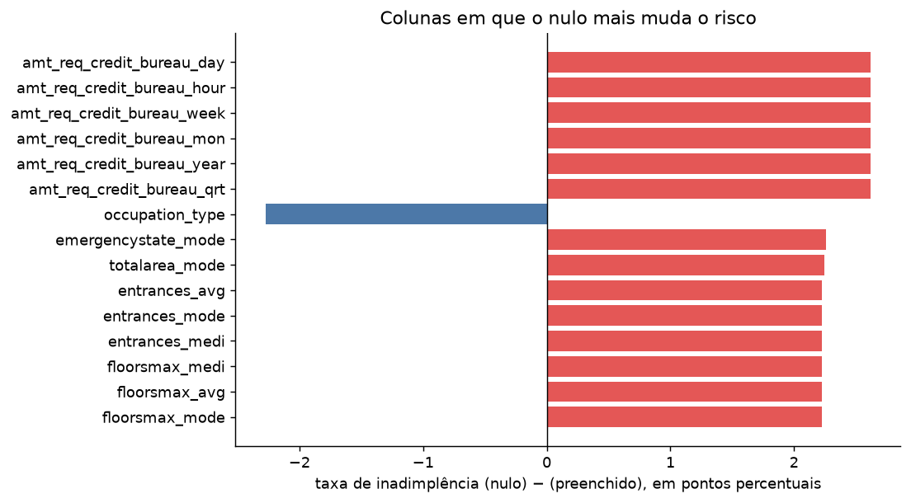
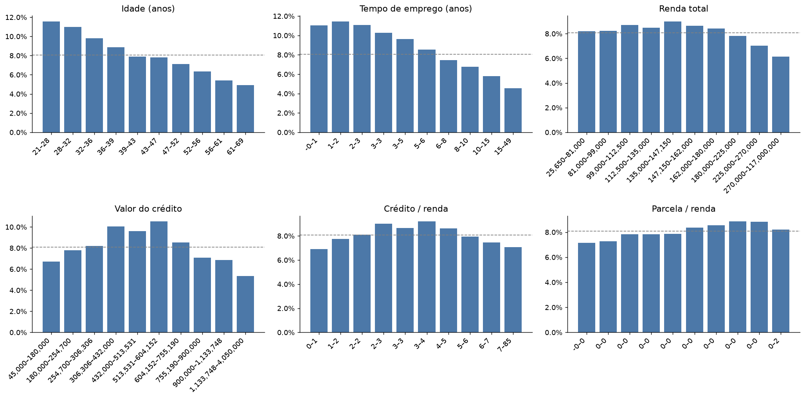
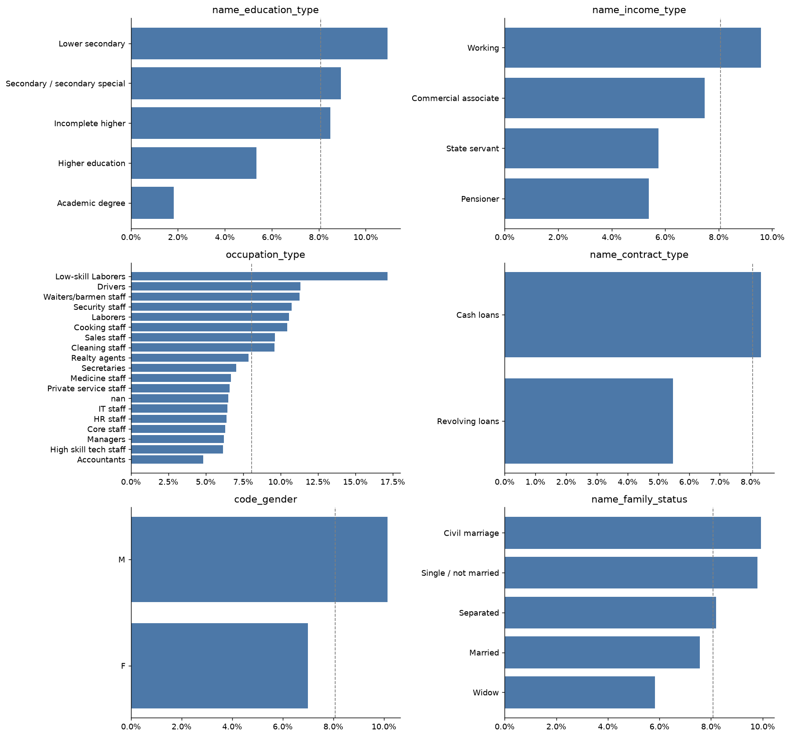
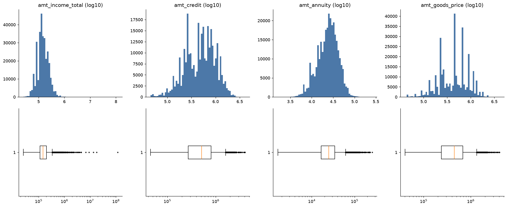
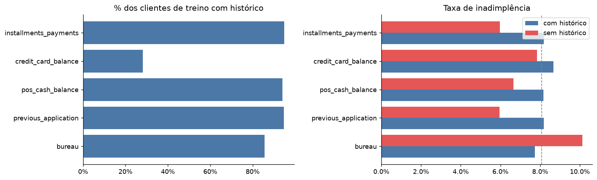

# Risco de inadimplência do Home Credit

## Introdução
Sabendo que as pessoas tem dificuldade em obter empréstimos devido a um histórico de crédito insuficiente ou inexistente. A empresa *Home Credit*, busca atender a população, ampliando seus serviços para pessoas não "bancarizada", proporcionando um experiencia segura e positiva de empréstimo.
Os dados contam com informações de telecomunicações, bancária e transações para prever a capacidade de pagamento de seus clientes.

## Objetivo
Este projeto tem como finalidade fazer um estudo de caso, simulando uma 
atividade cotidiana como cientista de dados.
O *dataset* escolhido foi *home credit default risk*, disponível no link
https://www.kaggle.com/c/home-credit-default-risk. O motivo de sua escolha é
proveniente do interesse do autor (eu mesmo, Alessandro Saito) pela área de 
crédito e risco.

## Metodologia 
### Coleta de dados
O repositório *Kaggle* de onde foram tirado os dados disponibilizam 10 arquivos .csv onde 2 deles não fazem parte dos dados sample_submission.csv é o formato de envio da competição e HomeCredit_columns_description.csv é o dicionário de colunas. Os oito arquivos restantes são tabelas contendo de fato os dados.
A tabela 1 mostra como as tabelas são organizadas 

**Tabela 1** – Tabelas de *Home Credit Default Risk*

| Arquivo | Conteúdo | Granularidade (uma linha por…) |
|---|---|---|
| `application_{train\|test}.csv` | Tabela principal, dividida em treino (com `TARGET`) e teste (sem `TARGET`). Dados estáticos de cada solicitação. | Empréstimo da amostra |
| `bureau.csv` | Créditos anteriores do cliente em outras instituições financeiras, reportados ao Serviço de Proteção ao Crédito. | Crédito anterior no cadastro, anterior à data da solicitação |
| `bureau_balance.csv` | Saldos mensais dos créditos anteriores do `bureau`. | Mês de histórico de cada crédito anterior |
| `POS_CASH_balance.csv` | Extratos mensais de empréstimos anteriores em ponto de venda (PDV) e em dinheiro, feitos com a Home Credit. | Mês de histórico de cada crédito anterior na Home Credit |
| `credit_card_balance.csv` | Extratos mensais dos cartões de crédito anteriores do solicitante na Home Credit. | Mês de histórico de cada cartão anterior |
| `previous_application.csv` | Solicitações anteriores de empréstimo na Home Credit, de clientes que têm empréstimo na amostra. | Solicitação anterior |
| `installments_payments.csv` | Histórico de reembolso dos créditos anteriores concedidos pela Home Credit. | Pagamento efetuado ou parcela em atraso |

### Postgesql
Os dados coletados foram importados para dentro de um *database* no Postgresql, para isso foi feito um *script* em *Python* para percorrer os arquivos .cvs, copiar os conteúdos das colunas, criar novas tabelas dentro do *Postgresql* e preencher as colunas com os dados copiados anteriormente.
Não foi possível criar as chaves estrangeiras (*foreign keys*) entre as tabelas, pois os dados originais contêm linhas órfãs, isto é, linhas filhas cuja chave não existe na tabela pai. O PostgreSQL só aceita uma chave estrangeira quando todas as linhas satisfazem a regra. Antes de criá-las, foi feita uma contagem de órfãs em cada relação, e o resultado está na Tabela 2. Antes dessa contagem, conferiu-se que o número de linhas de cada tabela importada coincide com o dos arquivos do *Kaggle*, o que descarta falha na importação.

**Tabela 2** – Linhas órfãs por relação entre tabelas

| Tabela filha | Tabela pai | Chave | Órfãs | % da filha |
|---|---|---|---|---|
| `bureau` | `application_train` | `sk_id_curr` | 251.103 | 14,6% |
| `previous_application` | `application_train` | `sk_id_curr` | 256.513 | 15,4% |
| `pos_cash_balance` | `application_train` | `sk_id_curr` | 1.457.983 | 14,6% |
| `credit_card_balance` | `application_train` | `sk_id_curr` | 612.347 | 15,9% |
| `installments_payments` | `application_train` | `sk_id_curr` | 2.013.809 | 14,8% |
| `bureau_balance` | `bureau` | `sk_id_bureau` | 3.120.184 | 11,4% |
| `pos_cash_balance` | `previous_application` | `sk_id_prev` | 340.561 | 3,4% |
| `installments_payments` | `previous_application` | `sk_id_prev` | 1.250.826 | 9,2% |
| `credit_card_balance` | `previous_application` | `sk_id_prev` | 1.082.816 | 28,2% |

As órfãs por `sk_id_curr` têm uma explicação provável, as tabelas auxiliares trazem também os clientes de `application_test`, que não foi importada para o banco. Já as órfãs por `sk_id_prev` e `sk_id_bureau` vêm dos próprios dados do *Kaggle*, e a documentação da competição não explica por quê. Como nenhuma relação passou na verificação, optou-se por não criar nenhuma chave estrangeira, nem em modo `NOT VALID`, que apenas esconderia a violação. As relações continuam existindo de forma lógica e são aplicadas nas consultas por meio de `LEFT JOIN` a partir de `application_train`, o que descarta as órfãs sem exigir filtros adicionais. Para acelerar essas junções, foram criados índices nas colunas de ligação.

## Resultado

### Análise exploratória de `application_train`
A tabela `application_train` tem 307.511 linhas e 122 colunas, uma por solicitação de empréstimo. Os gráficos a seguir foram gerados no notebook `notebooks/data_exploration.ipynb`.

#### Poucos inadimplentes
Só 8,07% dos clientes não pagaram, cerca de um em cada doze. Caso um modelo fosse treinado com esses dados e respondesse "pagou" para todo mundo, acertaria 91,93% das vezes, isso mostra que ele teve um *overfitting* nos dados e em seu treinamento não houve aprendizado algum. Por isso a acurácia fica de fora, e o modelo será avaliado por KS, Gini e AUC, que medem se ele coloca os maus pagadores acima dos bons.

**Figura 1** – Desbalanceamento do alvo

#### Valores ausentes
Das 122 colunas, 67 têm nulos e 41 passam de 50%. As mais afetadas descrevem o imóvel do cliente, como as `commonarea_*`, com cerca de 70% de nulos.

**Figura 2** – Colunas com mais valores ausentes

Foi levado em conta que os campos vazios podem ter um significado além de só falta de informação. Para poder separar os dois casos, comparou-se a inadimplência de quem tem o campo nulo com a de quem tem o campo preenchido. A maior diferença é de 2,6 pontos percentuais, nas colunas `amt_req_credit_bureau_*`. Existe sinal, mas pequeno. O indicador de nulo pode entrar como variável extra no modelo, sem grandes expectativas.

**Figura 3** – Diferença de inadimplência entre registros nulos e preenchidos

#### Investigação do `days_employed`
Em 55.374 linhas (18,0%), a coluna `days_employed` retorna o valor 365243. São cerca de mil anos de emprego, o número pode ser interpretado como um código ao invés de uma marcação de tempo de trabalho. Porque quase todas essas linhas (55.352) são de clientes com `name_income_type = Pensioner`, mas é só uma hipótese, não tem como saber de fato o que significa. A estratégia adotada foi trocar o valor por nulo, porque deixado como está ele faria o modelo tratar um aposentado como a pessoa há mais tempo empregada da base.

Plotando o gráfico para verificar os dados da coluna `days_employed`, é possível notar que o grupo do código inadimple ficou 5,4% contra 8,7% do restante. Ou seja, o nulo aqui tem significado, e vale guardar um indicador para ele em vez de apenas imputar.

**Figura 4** – Efeito da sentinela 365243 em `days_employed`

#### Variáveis numéricas e categóricas
A idade e o tempo de emprego mostram a relação mais limpa com a variável *target*. Na faixa de 21 a 28 anos a inadimplência passa de 11%, e na de 61 a 69 fica perto de 5%. O tempo de emprego segue o mesmo caminho, de cerca de 11% para quem tem até 3 anos de casa a menos de 5% para quem tem mais de 15. A renda quase não separa ninguém até a faixa dos 180 mil, e só nas duas últimas a inadimplência cai (para 7% e 6%). O valor do crédito e a razão crédito/renda não são monotônicos, o que sugere que uma regressão logística precisará de faixas e não de uma reta para poder generalizar aos dados.

**Figura 5** – Taxa de inadimplência por faixa de variáveis numéricas

Nos três `ext_source_*`, a mediana de quem foi inadimplente é menor que a de quem pagou. Em `ext_source_1`. As duas distribuições se sobrepõem bastante, então nenhuma delas resolve o problema sozinha.

**Figura 6** – Distribuição dos `ext_source_*` por classe do alvo

Entre as categorias, a escolaridade tem a maior amplitude. Quem tem só o ensino fundamental inadimple cerca de 11%, e quem tem título acadêmico, fica próximo de 2%. Em ocupação, trabalhadores braçais sem qualificação passam de 17% e contadores ficam abaixo de 5%. Homens tendem a inadimplirem mais que mulheres (cerca de 10% contra 7%), e empréstimo em dinheiro tendem a ser mais inadimplente do que crédito rotativo (cerca de 8,3% contra 5,5%). Em `occupation_type`, os nulos aparecem como uma categoria própria, perto de 6,5%.

**Figura 7** – Taxa de inadimplência por categoria

#### Outliers e qualidade dos dados
A renda é a variável mais assimétrica. Seu máximo é de 117 milhões, enquanto o percentil 99,9 é de 900 mil, o que indica um ou poucos registros muito fora do padrão. Esse tipo de valor distorce a média e atrapalha modelos sensíveis à escala, então a renda precisará de transformação (log, por exemplo) ou de corte.

Os demais testes de consistência passaram. Não há `sk_id_curr` duplicado, idade fora de 18 a 100 anos nem renda menor ou igual a zero. Há 4 linhas com `code_gender = XNA` e 8 clientes com mais de 10 filhos, casos raros demais para pesar na modelagem.

**Figura 8** – Distribuição e outliers dos valores monetários

#### Correlação com o *target*
Aplicando a correlação de Pearson, pode-se notar que nenhuma variável numérica tem correlação linear forte com `target`. As maiores pertencem as colunas `ext_source_*` (−0,18 para `ext_source_3`, −0,16 para `ext_source_2` e −0,16 para `ext_source_1`), seguidas pela *feature* `days_birth` (0,08) e `days_employed` (0,07). Mesmo a mais forte explica só uns 3% da variação do alvo (0,18² ≈ 0,03). O ganho do modelo virá da combinação de muitas variáveis fracas e de relações que não são lineares, como as da Figura 5.

**Figura 9** – Variáveis numéricas mais correlacionadas com `target`

### Cobertura das tabelas auxiliares
Nem todo cliente de `application_train` aparece nas tabelas auxiliares. A Figura 10 mostra quantos clientes têm ao menos uma linha em cada tabela e qual a inadimplência de quem tem e de quem não tem histórico. A `bureau_balance` ficou de fora, porque se liga por `sk_id_bureau` e não por `sk_id_curr`.

**Figura 10** – Cobertura das tabelas auxiliares e inadimplência com e sem histórico

| Tabela | Clientes com histórico | Inadimplência com histórico | Inadimplência sem histórico |
|---|---|---|---|
| `bureau` | 85,7% | 7,7% | 10,1% |
| `previous_application` | 94,7% | 8,2% | 6,0% |
| `pos_cash_balance` | 94,1% | 8,2% | 6,7% |
| `credit_card_balance` | 28,3% | 8,7% | 7,8% |
| `installments_payments` | 94,8% | 8,2% | 6,0% |

Não ter histórico muda o risco, e em sentidos opostos. Quem não aparece no `bureau` inadimple tem mais chance de ser inadimplente (10,1% contra 7,7%). Quem não tem pedido anterior na Home Credit tem menos chance de ser inadimplente (6,0% contra 8,2%). Não investiguei a causa desse segundo caso, e uma hipótese razoável é que a Home Credit já tenha filtrado melhor quem recebia o primeiro empréstimo, mas isso precisa ser testado.

Na modelagem, cada tabela ganhará um indicador de "tem histórico", em vez de tratar a ausência só como valor faltante. Só 28,3% dos clientes têm cartão de crédito na Home Credit, então as variáveis derivadas dessa tabela serão em sua maioria nulas.
